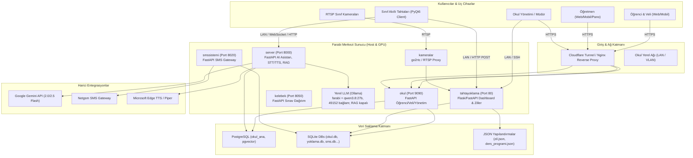
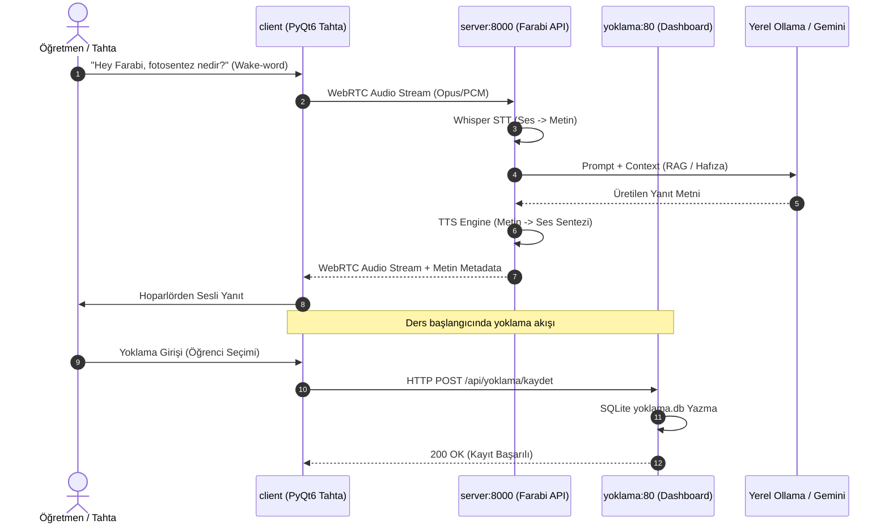

# SİSTEM MİMARİSİ (ARCHITECTURE)

> ⚠️ **DOĞRULANMAMIŞ — LLM üretimi (2026-10-29 toplu belge seti).** 2026-11-11 kod kontrolünde bu setteki belgelerin
> var olmayan dosyalara (`smssistemi/netgsm.py`, `server/services/stt_service.py`, `okul/rotalar/notlar.py`,
> `tahtayoklama/ziller/zil.py`) ve projede olmayan teknolojilere (Netgsm, go2rtc, Whisper, Nginx, Flask, `/home/pi`)
> atıf yaptığı görüldü. Kaynak değildir; bir bulguya göre iş yapmadan önce kodda doğrula. Esas: kök `AGENTS.md`,
> `docs/mimari.md`, `docs/runbook.md`, `DECISIONS.md`.

> **Belge Sürümü:** 1.0.0  
> **Tarih:** 29 Ekim 2026  
> **Kapsam:** Depodaki tüm bileşenlerin gerçek mimari yapısı ve çalışma prensipleri

---

## 1. Sistem Bağlam Diyagramı (System Context)

Aşağıdaki diyagram; kullanıcıların, donanım uç noktalarının, arka plan servislerinin ve harici sağlayıcıların Farabi ekosistemiyle nasıl etkileşime girdiğini göstermektedir.

---

## 2. Servisler Arası İletişim Mimarisi (Service Communication)

Farabi, monolitik bir yapıdan ziyade **gevşek bağlı çoklu mikro/modüler servisler (Multi-service Architecture)** modeliyle çalışmaktadır. Servisler arası etkileşim yöntemleri:

1. **HTTP REST API:**
   - `okul` ve `smssistemi` arasındaki veri doğrulama istekleri.
   - `tahtayoklama` paneli ile `kameralar` (RTSP snapshot) arasındaki REST çağrıları.
2. **WebSocket & WebRTC:**
   - `client` ile `server` arasında düşük gecikmeli iki yönlü ses iletimi (`/webrtc/offer`, `/ws/audio`).
   - Telemetri ve canlı durum bildirimleri (`/ws/telemetry`).
3. **Paylaşımlı Dosya Sistemi & SQLite:**
   - `tahtayoklama/dashboard/okul_ana_panel.py`, ziller ve ders programı güncellendiğinde `data/zil.json` ve `data/ders_programi.json` dosyalarını yazar; `tahtayoklama/ziller/zil.py` ve `client` bu dosyaları okur.
4. **PostgreSQL Entegrasyonu (`okul_ana`):**
   - e-Okul'dan aktarılan ana öğrenci, öğretmen, sınıf ve ders havuzu PostgreSQL üzerinde tutulur. `okul` ve `soruhavuzu` doğrudan PostgreSQL'e bağlanır.
5. **SSH / Paramiko:**
   - `tahtayoklama` paneli (`uzaktan_yonetim.py`, `uzaktan_baslat.py`), sınıflardaki akıllı tahtalara SSH üzerinden bağlanarak uzaktan komut yürütme, ekran görüntüsü alma ve yeniden başlatma işlemleri yapar.

---

## 3. Katmanlı Mimari ve Sorumluluk Ayrımı

### 3.1. `okul/` Portalı Katman Yapısı
- **Yönlendiriciler (Routers - `okul/rotalar/`):** 33 adet rota modülü (`auth.py`, `notlar.py`, `ogrenci.py`, `ogretmen.py`, `veli.py`, `yonetim.py`, `analitik.py`, `pano.py`, `sudoku.py` vb.). Sadece HTTP istek doğrulama, yetki kontrolü ve HTTP yanıtı oluşturma sorumluluğundadır.
- **Servis Katmanı (`okul/servisler/`):** İş mantığını barındıran servisler (`rapor.py`, `not_servisi.py`, `devamsizlik_servisi.py`).
- **Veri Erişim Katmanı (`okul/db.py`):** SQLite bağlantı havuzu, migration çalıştırıcı ve PostgreSQL (`okul_ana`) bağlantı köprüsü.
- **Yardımcı Modüller (`okul/deps.py`, `okul/auth.py`):** Dependency injection, rol bazlı erişim denetimi (`Rol.OGRENCI`, `Rol.OGRETMEN`, `Rol.MUDUR`), parola hashleme.

### 3.2. `server/` Asistan Katmanı
- **API Uç Noktaları (`server/routers/`):** `chat.py`, `voice.py`, `telemetry.py`, `rag.py`.
- **Servisler (`server/services/`):**
  - `llm_service.py`: Yerel Ollama ile Gemini API arasında dinamik yük dengeleme ve fallback.
  - `stt_service.py`: Whisper tabanlı konuşmadan metne dönüştürme.
  - `tts_service.py`: Edge-TTS ve Piper yerel ses motoru.
  - `rag_service.py`: Müfredat dokümanları ve okul kuralları üzerinde vektör arama.

### 3.3. `tahtayoklama/` Operasyon Katmanı
- **Dashboard:** Flask/FastAPI tabanlı arayüz, anlık tahta durumları, ping izleme.
- **Ziller Modülü (`tahtayoklama/ziller/`):** Hafta içi/hafta sonu ders saatleri, teneffüs zilleri, anons sistemi ve MP3 çalma otomasyonu.
- **Uzaktan Yönetim:** Paramiko tabanlı asenkron/senkron SSH agent yönetimi.

---

## 4. Mimari Kararlar ve Kök Neden Analizi (ADR Özeti)

1. **Çift LLM Stratejisi (Yerel GPU + Bulut Fallback):**
   - *Karar:* Yerel Ollama iki RTX 3060 üzerinde `qwen3.8:27b` çalıştırır; istemciler modeli `farabi` takma adıyla ister (49152 bağlam, süresiz yüklü). `gemma4:12b` diskte kullanılmadan durur; RAG ve embedding servisi kalıcı kapalıdır. Tahtaların ses yolu Gemini Live, metin sağlayıcı yedekleri ise `server/saglayicilar.py` zincirleridir.
   - *Gerekçe:* İnternet bağımlılığını en aza indirmek, kurum içi öğrenci verilerini korumak (KVKK) ve sıfır API maliyeti sağlamak.
2. **PostgreSQL + SQLite Hibrit Depolama:**
   - *Karar:* Temel okul kimlikleri ve vektör verisi PostgreSQL'de (`okul_ana`); hızlı işlem gerektiren operasyonel veriler (günlük yoklama, SMS kuyrukları, sudoku skorları) alt projelerin kendi SQLite veritabanlarında saklanır.
   - *Gerekçe:* Alt projelerin birbirinden bağımsız geliştirilebilmesi ve sunucu göçlerinin kolay olması. Ancak bu durum ACID sınırları ve veri senkronizasyonu açısından teknik borç yaratmaktadır (Bkz: `docs/TECHNICAL_DEBT.md`).
3. **WebRTC Ses İletişimi:**
   - *Karar:* Akıllı tahta mikrofon ve hoparlör iletişimi HTTP yerine WebRTC (veya düşük gecikmeli WebSocket PCM) üzerinden yapılır.
   - *Gerekçe:* Sınıf ortamında öğretmen ile asistan arasındaki diyalog gecikmesini (latency) 500ms altına indirmek.
