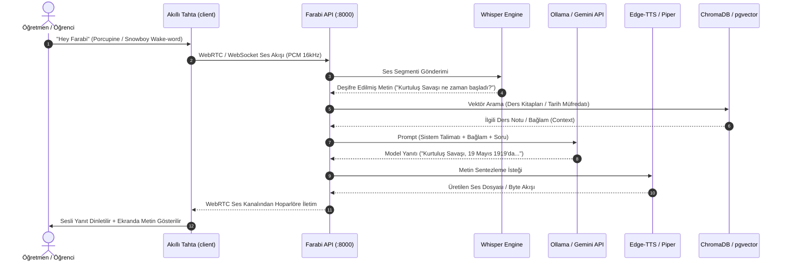
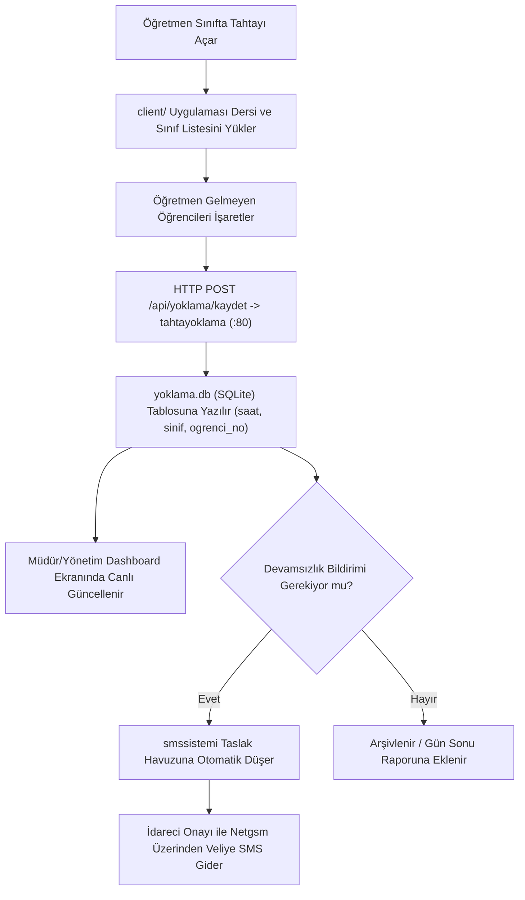
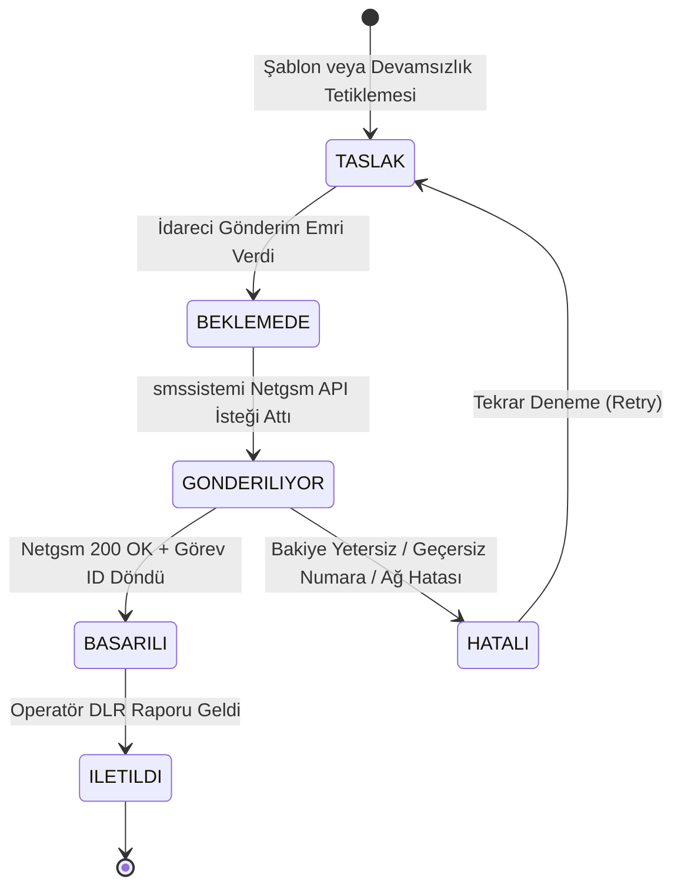

# VERİ AKIŞLARI (DATA FLOW)

> ⚠️ **DOĞRULANMAMIŞ — LLM üretimi (2026-10-29 toplu belge seti).** 2026-11-11 kod kontrolünde bu setteki belgelerin
> var olmayan dosyalara (`smssistemi/netgsm.py`, `server/services/stt_service.py`, `okul/rotalar/notlar.py`,
> `tahtayoklama/ziller/zil.py`) ve projede olmayan teknolojilere (Netgsm, go2rtc, Whisper, Nginx, Flask, `/home/pi`)
> atıf yaptığı görüldü. Kaynak değildir; bir bulguya göre iş yapmadan önce kodda doğrula. Esas: kök `AGENTS.md`,
> `docs/mimari.md`, `docs/runbook.md`, `DECISIONS.md`.

> **Belge Sürümü:** 1.0.0  
> **Tarih:** 29 Ekim 2026  
> **Kapsam:** Sistemin tüm kritik iş akışlarındaki veri üretim, iletim, işleme ve saklama adımları

---

## 1. Kritik İş Akışları Genel Bakış

Farabi platformunda veri, gerçek zamanlı telemetriden kalıcı veritabanı kayıtlarına kadar çok çeşitli hatlar üzerinden akar. 5 temel iş akışı şunlardır:

1. **Akıllı Tahta Asistanı Ses/Sohbet Akışı (Voice/AI Loop)**
2. **Sınıf Yoklama ve Devamsızlık Kayıt Akışı**
3. **SMS Gönderim ve Onay Yaşam Döngüsü**
4. **Okul Portalı Analitik ve Pano Senkronizasyonu**
5. **Kazanım Bazlı Soru Havuzu ve Sınav Kitapçığı Üretimi**

---

## 2. Akıllı Tahta Asistanı Akışı (Voice & AI Pipeline)



### Teknik Detaylar:
- **Gecikme (Latency):** Ses girişinden ilk token/ses çıktısına kadar geçen hedef süre yerel GPU üzerinde 800-1200ms arasındadır.
- **Güvenlik/Gizlilik:** Ses verisi diskte saklanmaz; hafızada (RAM buffer) işlenip yok edilir.

---

## 3. Sınıf Yoklama Akışı (Attendance Lifecycle)



---

## 4. SMS Gönderim ve Yaşam Döngüsü (SMS Pipeline)



### Kritik Nokta:
- SMS gönderimlerinde TOCTOU (Time-of-Check to Time-of-Use) zafiyetini önlemek amacıyla taslak durumunun asenkron iş parçacığı başlatılmadan önce `ISLENIYOR` olarak kilitlenmesi gerekmektedir (Bkz: `docs/SECURITY_AUDIT.md` ve `docs/CODE_QUALITY_AUDIT.md`).

---

## 5. Okul Portalı Analitik ve Pano Senkronizasyonu

```mermaid
flowchart LR
    subgraph KULLANICI_ETKILESIMI["Portal Etkileşimi"]
        Kullanici["Öğrenci / Öğretmen"] -->|Sayfa Ziyareti / Not Girişi| OkulApp["okul (FastAPI)"]
    end

    subgraph BUFFER_KATMANI["Analitik Arabellek (RAM)"]
        OkulApp -->|Middleware: analitik_kaydet| EventBuffer["Queue / RAM Buffer (25 Olay)"]
    end

    subgraph VERI_TABANI["Kalıcı Depolama"]
        EventBuffer -->|Flush (Her 5s / 25 Olayda Bir)| SQLiteAnalitik[("okul.db: analitik_olaylar")]
        OkulApp -->|Doğrudan Sorgu / Cache| SQLiteOkul[("okul.db: notlar, devamsizlik")]
    end

    subgraph DIJITAL_PANO["Koridor Dijital Panoları"]
        Pano["TV / Pano İstemcisi"] -->|GET /api/pano| OkulApp
        OkulApp -->|Nöbetçi Öğretmen, Günün Menüsü, Kutlamalar| Pano
    end
```

---

## 6. Soru Havuzu ve Sınav Kitapçığı Üretimi (Exam Generation)

1. **Girdi:** Öğretmen veya yönetici web arayüzünden ders, ünite, kazanım kodu (`KAZ_10_MAT_01`) ve zorluk derecesi seçer.
2. **Sorgu:** `soruhavuzu`, PostgreSQL `okul_ana` üzerindeki pgvector vektör alanından semantik benzerlik ve kazanım filtresi ile en uygun $N$ adet soruyu çeker.
3. **Derleme:** `kazanimtest` servisi ReportLab motorunu çalıştırarak A4 formatında, çift sütunlu, okul logolu ve karekodlu öğrenciye özel PDF sınav kitapçığı üretir.
4. **Çıktı:** PDF dosyası `/static/sinavlar/` dizininde oluşturulur ve kullanıcıya indirme bağlantısı döndürülür.
