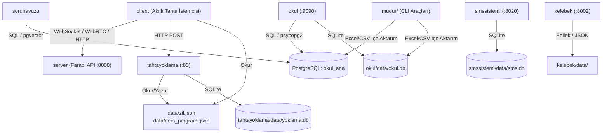

# BAĞIMLILIK HARİTASI (DEPENDENCY MAP)

> **Belge Sürümü:** 1.0.0  
> **Tarih:** 29 Ekim 2026  
> **Kapsam:** Depo içi modül bağımlılıkları, kütüphaneler, harici servisler ve veri kaynakları haritası

---

## 1. Modül ve Paket Bağımlılık Matrisi

Aşağıdaki matris, Farabi reposundaki alt projelerin birbirlerine ve ortak dosyalara olan doğrudan bağımlılıklarını göstermektedir:

---

## 2. Alt Proje Bağımlılık Detayları

### 2.1. `server/` (Farabi API)
- **Harici Python Kütüphaneleri:** `fastapi`, `uvicorn`, `aiortc`, `websockets`, `pydantic`, `chromadb`, `numpy`, `torch` (Whisper opsiyonel), `google-genai`, `edge-tts`.
- **Sistem Bağımlılıkları:** `ffmpeg` (ses işleme), NVIDIA CUDA toolkit (Ollama & Whisper için).
- **Ağ Bağımlılıkları:**
  - `http://localhost:11434` (Ollama yerel servisi)
  - `https://generativelanguage.googleapis.com` (Gemini API)
- **Depo İçi Bağımlılık:** `shared/` ve yapılandırma dosyaları.

### 2.2. `client/` (Akıllı Tahta GUI)
- **Harici Python Kütüphaneleri:** `PyQt6`, `PyQt6-WebEngine`, `sounddevice` / `pyaudio`, `requests`, `websockets`, `webrtc` bileşenleri.
- **Sistem Bağımlılıkları:** `pulseaudio` / `alsa`, `xdotool` / `wlr-randr` (ekran karartma/açma), `mpv` veya `aplay`.
- **Ağ Bağımlılıkları:** `http://192.168.1.X:8000` (server) ve `http://192.168.1.X:80` (yoklama).

### 2.3. `okul/` (Yönetim & Öğrenci Portalı)
- **Harici Python Kütüphaneleri:** `fastapi`, `uvicorn`, `jinja2`, `python-multipart`, `psycopg2-binary`, `sqlite3` (built-in), `passlib` / `hashlib`.
- **Veritabanları:**
  - `okul/data/okul.db` (Aktif SQLite)
  - `okul_ana` (PostgreSQL 16 veri ambarı)
- **Ön Yüz Varlıkları (Static):** Tailwind CSS (derlenmiş), Chart.js (CDN/yerel static), SortableJS, FontAwesome.

### 2.4. `tahtayoklama/` (Dashboard & Ziller)
- **Harici Python Kütüphaneleri:** `flask`, `fastapi`, `paramiko`, `sqlite3`, `apscheduler` / `schedule`, `pygame` (zil sesi çalma).
- **Donanım / Cihaz Bağımlılıkları:** Ses kartı / 3.5mm amfi çıkışı (okul hoparlörleri), sınıf tahtalarının SSH portları (`22/tcp`).
- **Veri Dosyaları:** `data/yoklama.db`, `data/zil.json`, `data/ders_programi.json`, `config/kameralar.json`.

### 2.5. `smssistemi/` (SMS Gateway)
- **Harici Python Kütüphaneleri:** `fastapi`, `uvicorn`, `httpx` / `requests`, `jinja2`.
- **Harici Servis:** `https://api.netgsm.com.tr` (XML/HTTP REST SMS API).
- **Veritabanı:** `smssistemi/data/sms.db`.

### 2.6. `soruhavuzu/`, `kazanimtest/`, `kelebek/`
- **`soruhavuzu`:** PostgreSQL `okul_ana` üzerindeki `sorular`, `kazanimlar` ve pgvector `embedding` tablolarına sıkı sıkıya bağlıdır.
- **`kazanimtest`:** `reportlab`, `pypdf`, `pdf2image` kütüphanelerine ve sistemde `poppler-utils` kurulu olmasına bağımlıdır.
- **`kelebek`:** Saf Python optimizasyon algoritmaları içerir, dış bağımlılığı düşüktür; girdi olarak CSV/JSON sınıf ve öğrenci listeleri alır.

---

## 3. Servis Port & Ağ Çakışma Haritası

| Port | Protokol | Servis | Yetkilendirme | Erişim Alanı |
| :--- | :--- | :--- | :--- | :--- |
| **8000** | HTTP / WS / WebRTC | `farabi-api` (server) | Token / API Key / Açık Uçlar | Kurum İçi LAN |
| **9090** | HTTP | `farabi-okul` (okul portalı) | Oturum Cookie (Session) | LAN & İnternet (Cloudflare) |
| **80** | HTTP | `farabi-yoklama-dashboard` | HTTP Basic Auth / Session | Kurum İçi LAN (İdari Ağ) |
| **8020** | HTTP | `farabi-smssistemi` | Oturum Cookie (Session) | Kurum İçi LAN & VPN |
| **8050** | HTTP | `farabi-kelebek` | Oturum Cookie / Local | Kurum İçi LAN |
| **11434**| HTTP REST | `ollama` | Yok (Localhost only) | `127.0.0.1` |
| **5432** | PostgreSQL Wire | PostgreSQL 16 (`okul_ana`) | Parola / pg_hba | `127.0.0.1` / Yerel Ağ |
| **8554** | RTSP / WebRTC | `farabi-kameralar` (go2rtc) | Yok / RTSP URL Auth | Kurum İçi LAN |
| **8010** | HTTP | Atos / AnythingLLM (`pm2-anythingllm`) | Uygulama İçi Giriş | LAN |
