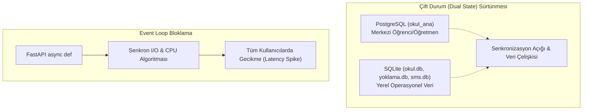

# TEKNİK BORÇ RAPORU (TECHNICAL DEBT)

> ⚠️ **DOĞRULANMAMIŞ — LLM üretimi (2026-10-29 toplu belge seti).** 2026-11-11 kod kontrolünde bu setteki belgelerin
> var olmayan dosyalara (`smssistemi/netgsm.py`, `server/services/stt_service.py`, `okul/rotalar/notlar.py`,
> `tahtayoklama/ziller/zil.py`) ve projede olmayan teknolojilere (Netgsm, go2rtc, Whisper, Nginx, Flask, `/home/pi`)
> atıf yaptığı görüldü. Kaynak değildir; bir bulguya göre iş yapmadan önce kodda doğrula. Esas: kök `AGENTS.md`,
> `docs/mimari.md`, `docs/runbook.md`, `DECISIONS.md`.

> **Belge Sürümü:** 1.0.0  
> **Tarih:** 29 Ekim 2026  
> **Kapsam:** Farabi mimarisindeki yapısal sürtünmeler, bakım maliyetleri, yinelenen mantıklar ve refactor gereksinimleri

---

## 1. Mimari Teknik Borçlar

---

## 2. Temel Borç Maddeleri ve Etki Analizi

### 2.1. Dağınık Veritabanı ve Çift Durum (Dual State) Problemi
- **Mevcut Durum:** Öğrenci kimlikleri hem PostgreSQL `okul_ana` veritabanında hem de `okul/data/okul.db` ve `smssistemi/data/sms.db` SQLite veritabanlarında ayrı ayrı tutulmaktadır.
- **Yarattığı Sorun:** Bir öğrencinin sınıfı veya telefon numarası değiştiğinde birden fazla veritabanını aynı anda güncellemek gerekmektedir. İki fazlı commit (2PC) bulunmadığı için veritabanları arasında tutarsızlıklar oluşmaktadır.
- **Borç Puanı:** **Yüksek**

---

### 2.2. Asenkron Rotalarda Senkron ve Ağır İşlemler
- **Mevcut Durum:**
  - `tahtayoklama/dashboard/kameralar.py`: 25 saniyelik senkron `subprocess.run`.
  - `okul/rotalar/sudoku.py`: 20.000 iterasyonluk backtracking solver.
  - `kelebek/app.py`: 4.000 iterasyonluk optimizasyon döngüsü.
  - `okul/deps.py`: Her istekte disk I/O yapan SQLite güncellemesi.
- **Yarattığı Sorun:** Python'un tek iş parçacıklı asyncio olay döngüsü bu işlemler sırasında tamamen kilitlenmekte, mikroservislerin eşzamanlı istek işleme kapasitesi düşmektedir.
- **Borç Puanı:** **Kritik**

---

### 2.3. Ölü Kod ve Yarıda Kalmış Migrasyonlar
- **Mevcut Durum:** `smssistemi/app.py` içinde 23 Ekim 2026'da `HTTPException(410)` eklenen uç noktaların altında onlarca satır ölü kod bırakılmıştır. Ayrıca testler güncellenmediği için CI koşumlarında 2 test başarısız olmaktadır.
- **Borç Puanı:** **Orta**

---

### 2.4. Bağımsız Oturum ve Yetkilendirme Mekanizmaları
- **Mevcut Durum:** `okul`, `tahtayoklama`, `smssistemi` ve `server` her biri kendi bağımsız oturum/çerez tablosunu yönetmektedir. Tekil oturum açma (Single Sign-On - SSO) veya ortak bir JWT/Session doğrulayıcı katmanı yoktur.
- **Yarattığı Sorun:** Bir öğretmen panele giriş yaptığında diğer servislere ayrı ayrı giriş yapmak zorunda kalmakta veya zayıf güvenlikli geçiş köprüleri kurulmaktadır.
- **Borç Puanı:** **Yüksek**

---

### 2.5. Yinelenen Altyapı ve Veritabanı Kodu (Boilerplate)
- **Mevcut Durum:** SQLite bağlantı havuzu, WAL pragma ayarları, şifre hashleme ve dosya yükleme yardımcıları 4 farklı projede kopyala-yapıştır yöntemiyle çoğaltılmıştır.
- **Yarattığı Sorun:** Bir hata düzeltildiğinde (örn. SQLite busy timeout) diğer 3 alt projede unutulmakta ve hata devam etmektedir.
- **Borç Puanı:** **Orta**
