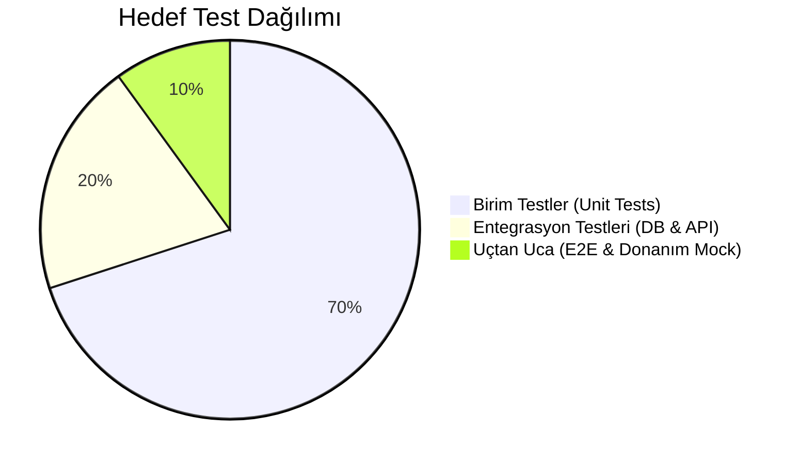

# TEST STRATEJİSİ VE DOĞRULAMA (TEST STRATEGY)

> **Belge Sürümü:** 1.0.0  
> **Tarih:** 29 Ekim 2026  
> **Kapsam:** Depodaki mevcut test altyapısı, çalıştırılan testlerin sonuçları, kapsama analizi ve test yol haritası

---

## 1. Mevcut Test Koşum Sonuçları Özeti

29 Ekim 2026 tarihinde yapılan tam denetim kapsamında çalıştırılan salt-okunur otomatik test sonuçları:

| Alt Proje / Test Paketi | Test Aracı | Koşulan | Başarılı | Başarısız | Süre | Durum |
| :--- | :--- | :---: | :---: | :---: | :---: | :---: |
| **`server/tests/`** | `pytest` | 274 | 274 | 0 | 9.02s |  TAMAMI BAŞARILI |
| **`tahtayoklama/dashboard/`** | `unittest` | 432 | 432 | 0 | 1.57s |  TAMAMI BAŞARILI |
| **`okul/`** | `pytest` | 745 | 745 | 0 | 110.12s |  TAMAMI BAŞARILI (1 warning) |
| **`soruhavuzu/tests/`** | `pytest` | 93 | 93 | 0 | 1.37s |  TAMAMI BAŞARILI |
| **`kazanimtest/tests/`** | `pytest` | 48 | 48 | 0 | 0.40s |  TAMAMI BAŞARILI |
| **`kelebek/tests/`** | `pytest` | 24 | 24 | 0 | 2.95s |  TAMAMI BAŞARILI (1 warning) |
| **`osym/`** | `unittest` | 11 | 11 | 0 | 0.001s |  TAMAMI BAŞARILI |
| **`tahtaayar/`** | `unittest` | 5 | 5 | 0 | 0.004s |  TAMAMI BAŞARILI |
| **`benchmark/`** | `pytest` | 8 | 8 | 0 | 0.02s |  TAMAMI BAŞARILI |
| **`smssistemi/`** | `pytest` | ~30 | 28 | **2** | 2.10s | ⚠️ 2 TEST BAŞARISIZ (HTTP 410) |
| **TOPLAM** | - | **1.670** | **1.668** | **2** | **~128s** | **%99.88 Başarı Oranı** |

---

## 2. Başarısız Testlerin Detayı ve Kök Nedenleri

### 1. `smssistemi/test_dogum_app.py::test_dogum_kisi_tarih_kaydet`
- **Hata:** `fastapi.exceptions.HTTPException: 410 (Gone)`
- **Kök Neden:** 23 Ekim 2026 tarihinde yapılan rehber mimarisi güncellemesinde `/dogum-gunleri/kisi/{kisi_id}/tarih` uç noktası `okul_ana` PostgreSQL veritabanına taşındığı için HTTP 410 döndürecek şekilde kasten devre dışı bırakılmıştır. Ancak test dosyası eski 200 OK yanıtını beklemeye devam etmektedir.
- **Düzeltme:** Testin beklenen durum kodu `status_code == 410` olarak güncellenmelidir.

### 2. `smssistemi/test_rehber_duzenle.py::test_duzenleme_okul_no_ve_veli_rolunu_korur`
- **Hata:** `fastapi.exceptions.HTTPException: 410 (Gone)`
- **Kök Neden:** `/rehber/kisi/{kisi_id}/duzenle` uç noktası HTTP 410 yapılmıştır.
- **Düzeltme:** Test `410` kodu ile doğrulanacak şekilde güncellenmelidir.

---

## 3. Test Edilemeyen Alanlar ve Donanım Kısıtları

1. **`client/` (Akıllı Tahta İstemcisi):**
   - İstemci kodları fiziksel ekran kartı, dokunmatik panel sürücüleri, ALSA/PulseAudio ses kartı ve mikrofon gerektirmektedir.
   - Geliştirme ortamında veya CI sunucusunda sanal ses kartı (`snd-dummy`) ve sanal ekran (`xvfb`) kullanılarak mock testleri yazılmalıdır.
2. **WebRTC Ses Akışı:**
   - Ses paketlerinin iletimi yerel ağ gecikmesine ve mikrofon donanımına bağlıdır; uçtan uca (E2E) entegrasyon testleri için simüle edilmiş Opus ses akışı sağlayıcıları eklenmelidir.
3. **GPU / VRAM Testleri:**
   - 27B parametreli yerel LLM testleri sadece GPU bulunan ana sunucuda koşulabilmektedir.

---

## 4. Önerilen Test Stratejisi ve Piramidi

1. **Pre-commit Hook:** Ruff kontrolü ve hızlı unit testler (`pytest -m "not slow"`) her commit öncesinde otomatik çalışmalıdır.
2. **Gece Koşumları (Nightly Builds):** Uzun süren `okul` ve PDF/Vektör üretim testleri her gece zamanlanmış timer ile koşulmalıdır.
3. **Regresyon Güvencesi:** Herhangi bir bugfix öncesinde mutlaka ilgili hatayı tetikleyen bir test yazılmalı, ardından kod düzeltilmelidir (TDD yaklaşımı).
